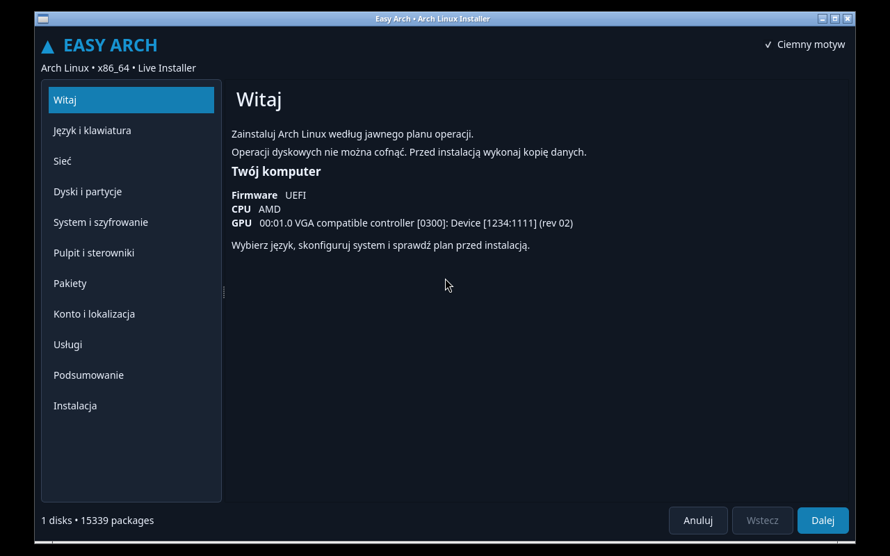
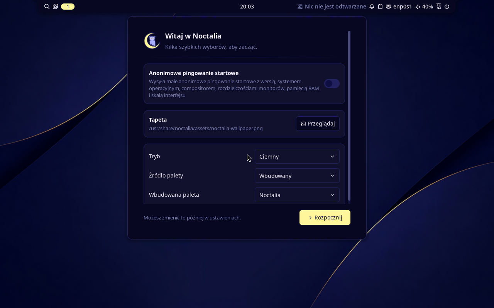

# Easy Arch

A real Python/Qt6 installer backend and desktop wizard for Arch Linux x86_64. This is **pre-release software**. See [executed test results](docs/test-results.md) before using it. Four real VM installation scenarios have passed boot and graphical login checks: UEFI/KDE/ext4, manual Btrfs/Hyprland/Noctalia with preserved ESP/data, BIOS/GRUB/KDE, and UEFI/LUKS2/KDE. Physical hardware qualification is still pending.

Download the bootable pre-release ISO and `SHA256SUMS` from [GitHub Releases](https://github.com/Jan-Bladek/easy-arch/releases/tag/v0.1.0-alpha.1). Repository access is required while this project is private.



The wizard provides Polish/English interface text, dark/light themes, hardware detection, automatic GPT partitioning, a manual partition editor, official repository package search/groups, KDE Plasma or Hyprland + Noctalia, account configuration, services, an explicit operation plan and streamed installation logs. Installation uses `pacstrap`, `arch-chroot`, `pacman`, `sfdisk`, `cryptsetup`, `mkinitcpio` and the selected bootloader. There are no simulated install commands in the backend.

## Run the read-only GUI

On Arch Linux:

```sh
sudo pacman -S --needed python pyside6 python-pip pciutils networkmanager nm-connection-editor
python -m venv --system-site-packages .venv
.venv/bin/pip install -e '.[test]'
.venv/bin/easy-arch --dry-run
```

`--dry-run` reads hardware and existing official pacman sync databases, validates intent and displays/exports a plan. It does not synchronize system databases, mount, format, invoke the privileged backend or write system configuration. It can save a plan/log **only when you ask it to**. No root is required. CLI: `easy-arch --dry-run --config configuration.json` prints a plan to stdout. Device configurations must use the actual detected identity, not just `/dev/sdX`.

Real installation is restricted to an installer live environment. Build the [live ISO](docs/iso.md), boot a disposable VM and run the GUI. Do not add the live marker to your normal computer to bypass that restriction.

## Implemented configuration paths

- UEFI: systemd-boot or GRUB; BIOS: GRUB on GPT with a BIOS boot partition.
- Automatic: separate unencrypted `/boot`, root ext4/Btrfs/XFS, optional swap. LUKS2 root uses Argon2id or PBKDF2, `sd-encrypt` and UUID-based boot arguments. Encrypted configurations allow zram instead of plaintext disk swap.
- Btrfs: `@`, `@home`, `@log`, `@snapshots`, compression; optional Snapper timelines and pacman snapshots.
- Manual GPT: create in free space, delete, explicitly format or preserve existing partitions; mount `/`, `/boot`, `/home`, `/var/log`, `/srv`, `/opt`. Existing ESPs are preserved unless explicitly formatted; deleting them is blocked. Root must be a fresh filesystem. No resizing. A FAT ESP >=1 GiB is required for UEFI. A BIOS boot partition is required for BIOS.
- Official packages only; dependency/conflict checks and downloads happen before the first disk write. No AUR helper or third-party package repository is needed.
- Kernels: linux, linux-lts, linux-zen, linux-hardened, multiple selections. CPU microcode and Mesa/Vulkan selection. NVIDIA open DKMS is an explicit Turing+ selection; auto uses Mesa/Nouveau conservatively.
- KDE Plasma Wayland/SDDM or Hyprland **0.56.x** with Noctalia **5.x**, SDDM, portals, audio, networking, clipboard, lock, idle, screenshots, terminal, browser and file manager. Other Hyprland/Noctalia version families are blocked until their configuration has been updated.

These are implemented paths, **not a claim that every combination has passed an end-to-end boot test**. [Limitations](docs/limitations.md) are part of the support contract.

## Installed desktops




The screenshots show actual installed VM sessions. See the [test report](docs/test-results.md) for evidence and limits.

## Development

```sh
pip install -e '.[test]'
QT_QPA_PLATFORM=offscreen pytest -q
python -m build
```

See [architecture](docs/architecture.md), [technical research](docs/research.md), [test procedures and Proxmox](docs/testing.md), [troubleshooting](docs/troubleshooting.md) and [ISO builds](docs/iso.md).

Passwords are sent to the privileged process through stdin and never serialized into the operation plan or journal. Cancellation waits for the current command boundary. Already completed partition changes are **not rolled back**. Do not blindly repeat a failed installation on a disk containing data.

GPL-3.0-or-later. Not an official Arch Linux project.
